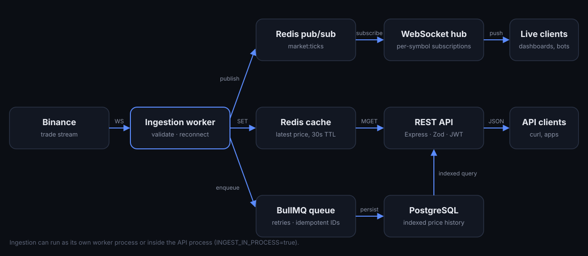

# MarketPulse

**Real-time crypto market data API.** Live trades are streamed from Binance, validated, cached in Redis, pushed to subscribers over WebSockets and persisted to PostgreSQL through a background queue.

**[Live dashboard](https://marketpulse-kozq.onrender.com)** · **[API docs](https://marketpulse-kozq.onrender.com/docs)** · [Health](https://marketpulse-kozq.onrender.com/health)

> Hosted on a free tier. If the first load takes ~30 seconds, the service is waking up.



## What it does

| | |
|---|---|
| **Ingest** | Holds a WebSocket to Binance's trade stream. Every message is validated with Zod; anything malformed is dropped before it reaches storage. Reconnects with exponential backoff (1s → 30s). |
| **Cache** | Each trade becomes the latest price in Redis with a 30-second TTL, so a stalled stream returns *no* price rather than a stale one. |
| **Fan out** | Trades are published on Redis pub/sub. Every API instance subscribes, so WebSocket clients get updates regardless of which instance they hit. |
| **Persist** | Writes go through a BullMQ queue (5 attempts, exponential backoff). Job IDs are `symbol-second`, which makes enqueueing idempotent: replays and bursts never create duplicate rows. |
| **Serve** | REST for latest prices (Redis `MGET`) and paginated history (PostgreSQL, `(symbol, eventTime DESC)` index). WebSocket subscriptions per symbol, with an instant snapshot on subscribe. |
| **Operate** | Health checks for Postgres and Redis, Prometheus metrics (request latency, ticks ingested/persisted, live WebSocket clients), structured Pino logs, rate limiting, Helmet, JWT auth. |

## Design decisions

- **Database writes are off the hot path.** The stream can deliver many trades per second; writing each one synchronously would couple stream throughput to database latency. The queue absorbs bursts and retries failures without blocking ingestion.
- **One row per symbol per second.** Full tick-level storage isn't needed for history charts, and it keeps the table small on free-tier Postgres. The job-ID scheme enforces this for free.
- **Prices are strings end to end.** Stored as `DECIMAL(30,10)` and serialised as strings, so no floating-point rounding is introduced anywhere in the pipeline.
- **Ingestion can run in-process or separately.** `INGEST_IN_PROCESS=true` runs it inside the API (one free web service). In production you'd run `npm run worker` as its own process so a slow stream or database never affects HTTP latency.
- **Pub/sub instead of in-memory broadcast.** It costs one Redis hop, but the API becomes horizontally scalable without sticky sessions.
- **Bounded backpressure.** Slow WebSocket clients with more than 1 MB buffered are skipped instead of growing server memory, and dead connections are terminated by a ping/pong heartbeat.

Trade-offs and failure modes are written up in [docs/failure-handling.md](docs/failure-handling.md).

## API

```bash
# Latest prices (Redis)
curl "https://marketpulse-kozq.onrender.com/api/market/latest?symbols=BTCUSDT,ETHUSDT"

# History, newest first (PostgreSQL)
curl "https://marketpulse-kozq.onrender.com/api/market/history?symbol=BTCUSDT&page=1&limit=25"
```

WebSocket: connect to `/ws` and send

```json
{ "type": "subscribe", "symbols": ["BTCUSDT", "ETHUSDT"] }
```

You get `{"type":"subscribed","snapshot":[...]}` with the current prices, then every trade as it happens. The full OpenAPI spec is at [`/docs`](https://marketpulse-kozq.onrender.com/docs) and [`/openapi.json`](https://marketpulse-kozq.onrender.com/openapi.json).

## Run locally

```bash
cp .env.example .env
docker compose up -d postgres redis
npm install
npx prisma migrate dev
npm run dev            # API + dashboard on http://localhost:4000
npm run dev:worker     # ingestion worker (or set INGEST_IN_PROCESS=true)
```

Or run the whole stack: `docker compose up --build`.

## Tests

```bash
npm test        # Vitest + Supertest
npm run lint    # tsc --noEmit
```

Tests cover stream parsing and validation, idempotent job IDs, reconnect backoff, request validation, auth protection, the WebSocket subscription contract and the HTTP surface. GitHub Actions runs type-checking, tests and the production build on every push.

## Deploy (Render, free tier)

`render.yaml` defines a single Docker web service in Frankfurt with ingestion in-process. Migrations run automatically on start (`npm run start:prod`). Add `DATABASE_URL` and `REDIS_URL` from your Render Postgres and Key Value instances.

Free services sleep after 15 minutes without traffic. A free uptime monitor (e.g. UptimeRobot) hitting `/health` every 10 minutes keeps it awake and the history continuous.

## Stack

Node.js 22 · TypeScript · Express 5 · PostgreSQL · Prisma · Redis (ioredis) · BullMQ · ws · Zod · Pino · prom-client · Vitest · Supertest · Docker · GitHub Actions
